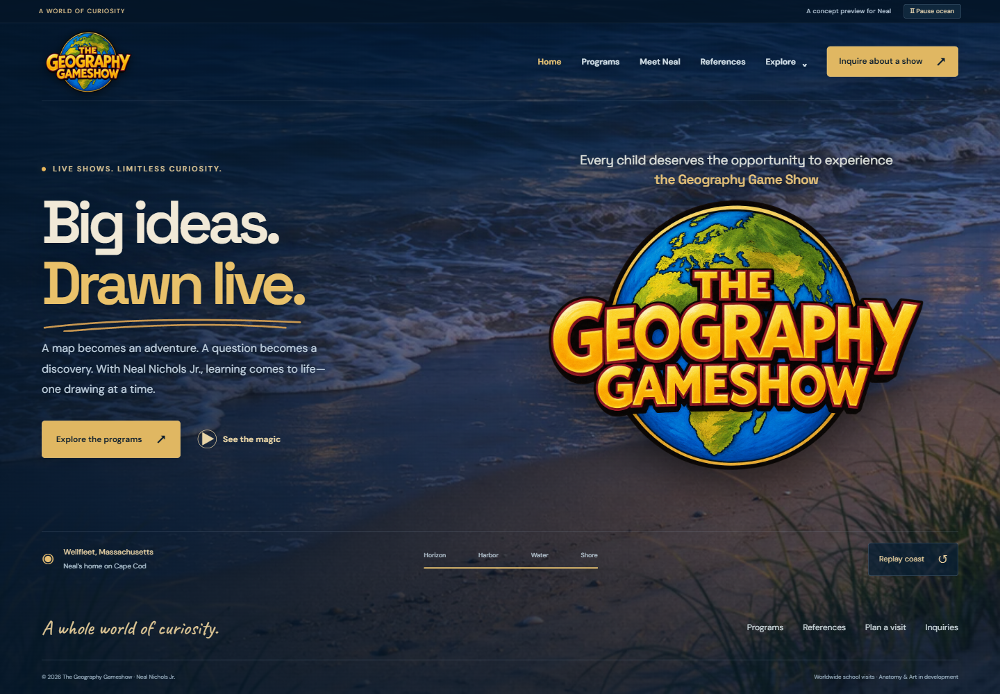

# The Geography Gameshow

**Big ideas. Drawn live.** A website concept for Neal Nichols Jr., bringing the original Geography Gameshow together with proposed Anatomy and Art shows.

[Open the live preview](https://wolfbreed1829.github.io/geography-gameshow/) · [Read the site review](docs/SITE-REVIEW.md)



## What is here

- A responsive dark-ocean design with a custom photographic water backdrop, drifting currents, warm gold accents, earthy land tones, and custom illustrations. Ocean motion can be paused and respects reduced-motion preferences.
- A compact homepage opening pans from a Wellfleet-inspired horizon and waterfront sign through cobalt water to the beach. It plays once per session with pause, skip, and replay controls; reduced-motion visitors see a still scene and immediate content. Artwork and its generation prompt are documented in [docs/COAST-PROMPT.md](docs/COAST-PROMPT.md).
- Neal’s actual classroom photos and artwork from his existing website.
- A compact homepage and a Programs hub linking to separate Geography, Anatomy, and Art pages.
- Separate pages for Meet Neal, the show in action, the challenge, school visit information, and inquiries.
- A searchable, paginated References & Press page with 38 named sources from the supplied collection and online research. Reviews expand directly on the page; school records, news, community mentions, and event listings have labeled summaries. Repeated visits and articles are grouped by source. No new photos, scans, or outbound reference links are published. Evidence is recorded in [docs/REFERENCES.md](docs/REFERENCES.md).
- Three playable, three-question challenges with scoring, feedback, and replay.
- An accessible mobile menu, native navigation links, expandable planning information, and reduced-motion support. The ocean pause setting follows visitors between pages for the session.
- An international inquiry form with school name, administrator/teacher name, email, phone, school address, country/territory, program, and optional details. It validates and displays a local review only. It **does not send, save, or submit inquiries**, and has no email handoff or form backend.
- School visit information adapted from Neal’s supplied school program document. Pricing, payment terms, deposits, and cancellation fees are excluded; the original PDF is not hosted.
- GitHub Actions builds the Rust application and publishes it to GitHub Pages.

This is a review concept. Anatomy and the new Art show are clearly marked as concepts in development. Geography program information comes from the original website and the supplied school program document. No prices, invented testimonials, availability, or endorsements are included.

## Run locally

Install a current stable Rust toolchain, the `wasm32-unknown-unknown` target, [Trunk](https://trunk-rs.github.io/trunk/), and Python 3 (used by the post-build page generator).

```sh
rustup target add wasm32-unknown-unknown
cargo install trunk --version 0.21.14 --locked
trunk serve
```

Open http://127.0.0.1:8080. The application is written in **Rust with Leptos 0.8 CSR**, compiled to WebAssembly. JavaScript is limited to the generated WASM loader; the application interactions live in Rust.

```sh
cargo fmt --all -- --check
cargo check --locked --target wasm32-unknown-unknown
trunk build --release --locked --public-url ./
```

The output is `dist/`. A Trunk post-build hook emits eleven HTML entry files with page-specific metadata, sharing the same hashed Rust/WASM and stylesheets. Native `.html` navigation supports direct links, refresh, and browser history on GitHub Pages without rewrite rules. Relative asset URLs support both a project path and a root-domain deployment. Fonts and visual assets are hosted locally. No third-party analytics or embedded tracking is included.

## Structure

| File | Purpose |
| --- | --- |
| `src/main.rs` | Shared navigation, page selection, ocean motion preference |
| `src/pages.rs` | Compact homepage, show in action, and Meet Neal |
| `src/coast.rs`, `coast.css` | Wellfleet homepage opening, camera pan, and motion controls |
| `src/programs.rs` | Programs hub and separate program detail pages |
| `src/planning.rs` | School visit information from the supplied document |
| `src/inquiry.rs` | International inquiry fields and local preview |
| `src/references.rs` | Text-only school, community, and press directory |
| `src/quiz.rs` | Quiz questions, feedback, score, and reset behavior |
| `style.css`, `ocean.css`, `pages.css` | Responsive page layouts, dark ocean identity, motion, and accessibility |
| `scripts/build-pages.py` | Standalone HTML entries and metadata for GitHub Pages |
| `public/` | Images, custom SVG illustrations, fonts and licenses |
| `.github/workflows/deploy.yml` | Reproducible Rust build and GitHub Pages deployment |
| `docs/SITE-REVIEW.md` | Review findings and recommended next steps |
| `docs/ASSETS.md` | Asset sources and rights notes |

## Optional illustration tooling

Node is used for optional illustration generation and browser tests, not to build or run the website. The normal Rust build does not require npm.

```sh
npm ci
npm run assets:globe
python scripts/download-fonts.py
```

## Browser verification

After building and serving `dist/` at port 8080:

```sh
npm ci
npx playwright install chromium
npm test
```

Set `PLAYWRIGHT_CHANNEL=msedge` to use an installed Microsoft Edge browser, or `PREVIEW_URL` to test another deployment. Browser checks cover assets, direct page URLs and internal links, a short homepage, all three quizzes, international inquiry validation and safe local review, the school information, mobile navigation, five viewport widths, and persistent motion pause/reduced-motion behavior.

## Before a full public launch

Ask Neal to confirm the new show names and descriptions, age ranges, current contact email, geography timings, technical needs, and permission to reuse the existing photos and artwork. Replace concept labels when each show is ready. A future production build should consider Leptos SSR or static prerendering for better initial HTML and search indexing; CSR is convenient for this GitHub Pages review.

Original Geography Gameshow photography, artwork, name, and content remain the property of their respective owners. Font licenses are included in `public/`; Natural Earth geographic data is public domain. No blanket license is granted over third-party assets.
