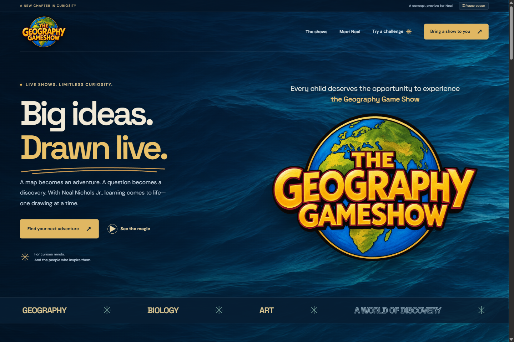

# The Geography Gameshow

**World maps illustrated from memory.** Educational performances for all ages with Neal Nichols Jr., featuring the original Geography Gameshow and a proposed Art show.

[Open the live preview](https://wolfbreed1829.github.io/geography-gameshow/) · [Read the site review](docs/SITE-REVIEW.md)



## What is here

- Fifteen standalone pages in Rust/Leptos. Every page fits the viewport, with sections, selectors, or pagination for additional content.
- The approved large-logo homepage over the water and beach, plus Request a Show in desktop and mobile navigation.
- Geography and Art programs with matching cinematic illustrations. Geography’s card uses a sketchbook composition inspired by Neal’s map; its Artwork tab preserves the original completed drawing in a gold frame.
- The Programs & Scheduling guide compares K–7 program choices and running times, lists additional titles, and shows one- and two-day visits with arrival and changeover guidance. “Ask About a Visit” opens an email to Neal’s published contact address.
- All original Geography and Art photos and verified videos remain available through selectors and gallery controls. Videos load only after play is selected.
- References includes the show introduction, Westbrook Hay Prep School excerpt, publication names, and all 38 named sources. Search and category filtering remain available. Long readings paginate to the actual available space without dropping text.
- Two three-question challenges, with scores, explanations, and replay.
- A four-step international inquiry form. Native validation applies to each step and values remain when going back. The review is paginated, including long entries. It **does not send, save, or submit inquiries**.
- Buttons use cascading color washes and pointer-reactive highlights. All decorative motion can be paused and respects reduced-motion preferences.

This is the GitHub Pages review site. The new Art show remains marked as in development. No prices, invented testimonials, availability, or endorsements have been added. The separate inquiry form still provides a local preview only.

## Run locally

Install a current stable Rust toolchain, the `wasm32-unknown-unknown` target, [Trunk](https://trunk-rs.github.io/trunk/), and Python 3 (used by the post-build page generator).

```sh
rustup target add wasm32-unknown-unknown
cargo install trunk --version 0.21.14 --locked
trunk serve
```

Open http://127.0.0.1:8080. For this local review, `./RUN-LOCAL.ps1` starts port 8090 and excludes generated test reports from the file watcher. The application is written in **Rust with Leptos 0.8 CSR**, compiled to WebAssembly. JavaScript is limited to the generated WASM loader; the application interactions live in Rust.

```sh
cargo fmt --all -- --check
cargo check --locked --target wasm32-unknown-unknown
trunk build --release --locked --public-url ./
```

The output is `dist/`. A Trunk post-build hook emits fifteen HTML entry files with page-specific metadata, sharing the same hashed Rust/WASM and stylesheets. Native `.html` navigation supports direct links, refresh, and browser history on GitHub Pages without rewrite rules. Relative asset URLs support both a project path and a root-domain deployment. Fonts and visual assets are hosted locally. No analytics service is configured. YouTube embeds connect to YouTube only after the visitor starts a video.

## Structure

| File | Purpose |
| --- | --- |
| `src/main.rs` | Shared navigation, page selection, ocean motion preference |
| `src/screen.rs`, `screens.css` | Viewport layouts, section selection, measured text pagination |
| `src/pages.rs` | Compact homepage, show in action, and Meet Neal |
| `src/coast.rs`, `coast.css`, `landing.css` | Logo-led homepage, coastal backdrop, responsive typography and booking actions |
| `src/programs.rs` | Programs hub and separate program detail pages |
| `src/planning.rs` | School visit information from the supplied document |
| `src/inquiry.rs` | International inquiry fields and local preview |
| `src/references.rs` | Featured video, school story, press, and paginated source directory |
| `src/quiz.rs` | Quiz questions, feedback, score, and reset behavior |
| `style.css`, `ocean.css`, `pages.css` | Responsive page layouts, dark ocean identity, motion, and accessibility |
| `experience.css` | Immediate homepage message, compact performance/reference band, interior artwork and reading surfaces |
| `scripts/build-pages.py` | Standalone HTML entries and metadata for GitHub Pages |
| `public/` | Images, custom SVG illustrations, fonts and licenses |
| `.github/workflows/deploy.yml` | Reproducible Rust build and GitHub Pages deployment |
| `docs/SITE-REVIEW.md` | Review findings and recommended next steps |
| `docs/ASSETS.md` | Asset sources and rights notes |

## Optional illustration tooling

Node is used for optional illustration generation and browser tests, not to build or run the website. The normal Rust build does not require npm.

```sh
npm ci
npm run assets:globe
python scripts/download-fonts.py
```

## Browser verification

After building and serving `dist/` at port 8080:

```sh
npm ci
npx playwright install chromium
npm test
```

Set `PLAYWRIGHT_CHANNEL=msedge` to use an installed Microsoft Edge browser, or `PREVIEW_URL` to test another deployment. Browser checks cover assets, direct page URLs and internal links, a short homepage, Geography and Art challenges, international inquiry validation and safe local review, the school information, mobile navigation, five viewport widths, and persistent motion pause/reduced-motion behavior.

## Before a full public launch

Ask Neal to confirm the new show names and descriptions, age ranges, current contact email, geography timings, technical needs, and permission to reuse the existing photos and artwork. Replace concept labels when each show is ready. A future production build should consider Leptos SSR or static prerendering for better initial HTML and search indexing; CSR is convenient for this GitHub Pages review.

Original Geography Gameshow photography, artwork, name, and content remain the property of their respective owners. Font licenses are included in `public/`; Natural Earth geographic data is public domain. No blanket license is granted over third-party assets.
